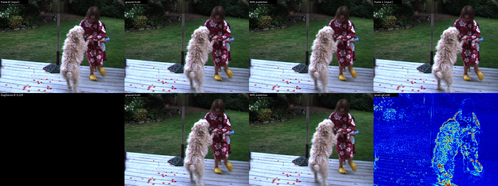
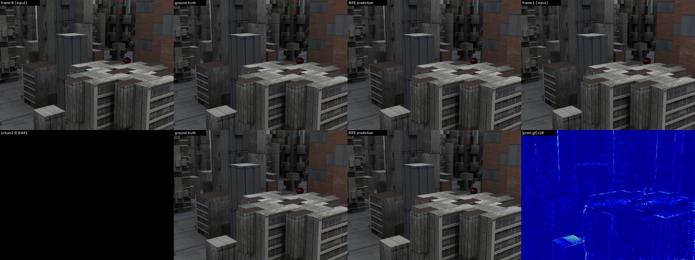
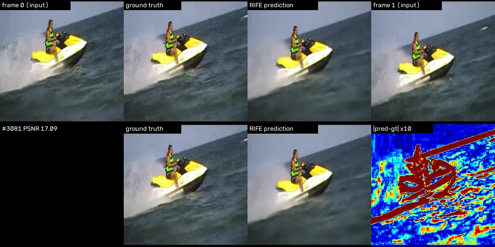
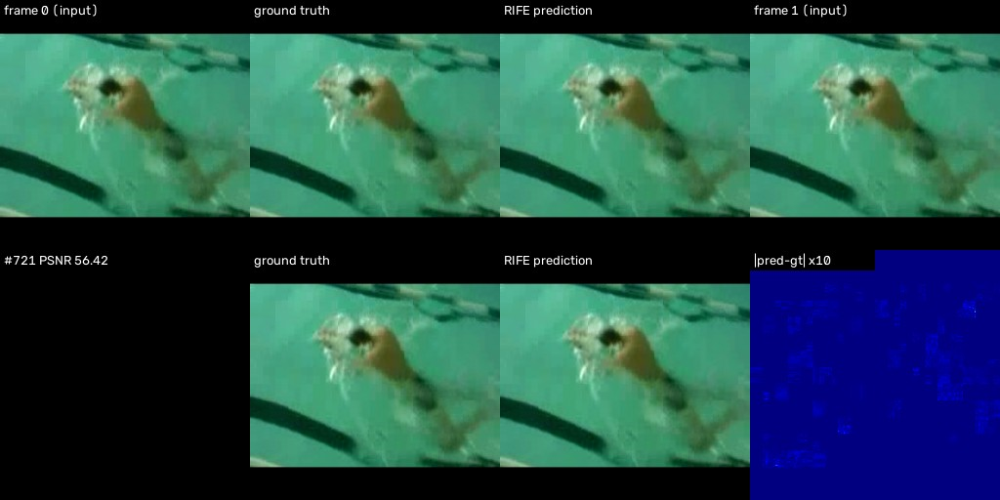

# RIFE 论文复现（CS543 视频插帧）

本仓库记录了 ECCV 2022 论文
[Real-Time Intermediate Flow Estimation for Video Frame Interpolation](https://arxiv.org/abs/2011.06294)（RIFE）的复现过程，
重点是在新版 PyTorch 和新显卡（如 RTX 50 系列）上跑通论文的评测。

- **本仓库不包含 RIFE 的代码、模型权重和数据集。** 代码和模型来自官方仓库
  [hzwer/ECCV2022-RIFE](https://github.com/hzwer/ECCV2022-RIFE)，数据集来自各自的发布方。
- 本仓库提供的内容：
  - 这份中文复现教程
  - 新版环境的依赖清单
  - 保存预测结果和对比图的脚本
  - 我们自己跑出来的评测日志和逐样本分数
  - 22 张代表性的预测对比图

## 复现结果

用作者发布的论文模型，在 UCF101 和 Middlebury 上复现了论文报告的数字，误差在 ±0.01 以内。官方代码**没有做任何修改**。

| 数据集 | 指标 | 论文 / 官方 README | 本次复现 | 差值 |
| --- | --- | --- | --- | --- |
| UCF101（379 组） | PSNR ↑（dB） | 35.282 | **35.292** | +0.010 |
| UCF101 | SSIM ↑ | 0.9688 | **0.9690** | +0.0002 |
| Middlebury other（12 个场景） | IE ↓ | 1.956 | **1.956** | ≈0 |
| Vimeo90K | PSNR / SSIM | 35.615 / 0.9779 | 未测（官方数据下载地址返回 403） | — |

0.01 dB 这个量级的差值来自不同 GPU、cuDNN 版本之间的浮点运算差异，属于正常范围。
完整日志和每个样本的分数在 [`results/`](results/) 目录里。

同一台机器上重复运行，单个样本的 PSNR 可能相差 ±0.002 dB 左右，这是 GPU（cuDNN）计算的非确定性造成的。不过保留三位小数时，平均值每次都一样。

**测试环境：**

| 项目 | 版本 |
| --- | --- |
| GPU | RTX 5080 16GB（sm_120） |
| 系统 | Windows 11 + WSL2 Ubuntu 24.04 |
| Python | 3.12.3 |
| PyTorch | 2.11.0+cu128 |
| numpy | 2.5.4 |
| opencv | 5.1.0 |
| 官方代码版本 | commit `5d8adbd` |

## 仓库结构

```
.
├── README.md                    本教程
├── requirements-cu128.txt       新版环境依赖（torch 需单独安装）
├── tools/
│   └── save_predictions.py      保存预测帧、对比图和逐样本分数
└── results/
    ├── benchmark_logs/          官方 benchmark 脚本的原始输出
    ├── ucf101_metrics.csv       UCF101 每组样本的 PSNR，从低到高排序
    ├── middlebury_metrics.csv   Middlebury 每个场景的 IE，从高到低排序
    └── compare/                 预测对比图（JPG）
        ├── middlebury/          全部 12 个场景
        └── ucf101/              PSNR 最低的 5 组（worst1–5）和最高的 5 组（best1–5）
```

---

## 复现步骤

整个流程大约 30 分钟，大部分时间花在下载 PyTorch（约 3GB）上。

### 0. 前提条件

- Linux，或 Windows 上的 **WSL2**（推荐 Ubuntu 22.04 或 24.04）
- NVIDIA 显卡和驱动
  - 在 WSL2 里，只要 Windows 装了新版驱动就行，不需要在 WSL 里另外安装驱动
  - 在 WSL 里运行 `nvidia-smi` 能看到显卡即可

> **为什么不用官方仓库自带的 `requirements.txt`？**
> 它锁定的是 `torch>=1.6`、`numpy<=1.23.5` 这些老版本。RTX 50 系列（Blackwell 架构，sm_120）
> 必须用 CUDA 12.8 以上编译的 PyTorch。实际测试中，RIFE 在新版 PyTorch 和 numpy 上
> **不改代码也能正常运行**。

### 1. 安装系统依赖

```bash
sudo apt update && sudo apt install -y git python3-venv unzip wget
```

### 2. 下载代码，创建独立的 Python 环境

下面把官方 RIFE 仓库和本仓库并排放在同一个工作目录下：

```bash
mkdir -p ~/work && cd ~/work
git clone https://github.com/hzwer/ECCV2022-RIFE.git
git clone https://github.com/ScatterBra/CS_543_Vedio_Interpolation.git

python3 -m venv ~/work/.venv            # 独立环境，不影响系统 Python
source ~/work/.venv/bin/activate

pip install --upgrade pip
# RTX 50 系列必须用 cu128；更老的显卡也可以用 cu128，或换成 cu126 等
pip install torch torchvision --index-url https://download.pytorch.org/whl/cu128
pip install -r CS_543_Vedio_Interpolation/requirements-cu128.txt
```

检查 GPU 是否可用：

```bash
python -c "import torch; print(torch.__version__, torch.cuda.is_available(), torch.cuda.get_device_name(0))"
```

应该输出 `True` 和你的显卡型号。

### 3. 下载论文模型

> **注意：** 官方 README 开头 "CLI Usage" 一节给的 HD 模型**不是**论文里用的模型，用它跑不出论文的数字。
> 论文模型是 README "Evaluation" 一节里的 "RIFE model"。

```bash
cd ~/work/ECCV2022-RIFE
gdown 1h42aGYPNJn2q8j_GVkS_yDu__G_UZ2GX -O RIFE_paper.zip
unzip RIFE_paper.zip "train_log/flownet.pkl"
rm RIFE_paper.zip
ls -lh train_log/flownet.pkl   # 约 43MB
```

新版 gdown 已经去掉了 `--fuzzy` 参数，直接传文件 id 就行。

### 4. 下载测试数据

数据都放在 **RIFE 仓库根目录**下，因为官方评测脚本是用相对路径读数据的。以下命令都在 `~/work/ECCV2022-RIFE` 中运行。

**Middlebury（约 38MB）**

```bash
wget https://vision.middlebury.edu/flow/data/comp/zip/other-color-allframes.zip
wget https://vision.middlebury.edu/flow/data/comp/zip/other-gt-interp.zip
unzip -q other-color-allframes.zip     # 解压得到 other-data/
unzip -q other-gt-interp.zip           # 解压得到 other-gt-interp/
rm other-color-allframes.zip other-gt-interp.zip
```

**UCF101（约 105MB）**

数据来自 DVF 作者主页 <https://liuziwei7.github.io/projects/VoxelFlow> 上的
**"Video Interpolation Results (UCF-101)"**。这个 Google Drive 链接是旧格式，gdown 下载不了，
需要**用浏览器手动下载**：
<https://drive.google.com/file/d/0B7EVK8r0v71pdHBNdXB6TE1wSTQ/view?usp=sharing&resourcekey=0-r6ihCy20h3kbgZ3ZdimPiA>

下载后得到 `ucf101_interp_ours.zip`，放到 `~/work/ECCV2022-RIFE/` 下，然后运行：

```bash
mkdir -p UCF101
unzip -q ucf101_interp_ours.zip -d UCF101/   # 解压得到 UCF101/ucf101_interp_ours/
ls UCF101/ucf101_interp_ours | wc -l         # 应该是 379
```

在 WSL 里，Windows 的"下载"文件夹路径是 `/mnt/c/Users/<用户名>/Downloads/`。

**Vimeo90K（可选）**

评测只需要测试集 `vimeo_interp_test.zip`，解压到 RIFE 仓库根目录的 `vimeo_interp_test/`，
不需要 33GB 的训练集。官方地址 <http://toflow.csail.mit.edu/> 目前访问时会返回 403。

准备好后，RIFE 仓库根目录应该是这样：

```
ECCV2022-RIFE/
├── train_log/flownet.pkl
├── other-data/<12 个场景>/frame10.png, frame11.png, ...
├── other-gt-interp/<12 个场景>/frame10i11.png
└── UCF101/ucf101_interp_ours/<379 个编号>/frame_00.png, frame_01_gt.png, frame_02.png
```

### 5. 运行官方评测

```bash
cd ~/work/ECCV2022-RIFE
python benchmark/MiddleBury_Other.py   # 约 5 秒
python benchmark/UCF101.py             # 约 10 秒
python benchmark/Vimeo90K.py           # 需要先准备好 Vimeo 数据
```

脚本每处理一个样本就打印一次**累计平均值**，看最后一行就行：

```
MiddleBury_Other.py  →  1.9562601030732598
UCF101.py            →  Avg PSNR: 35.29211644008107 SSIM: 0.9689808487892151
```

### 6. 保存并查看预测结果

官方脚本只打印分数，不保存图片。可以用本仓库的脚本把预测帧和对比图存下来：

```bash
cd ~/work
python CS_543_Vedio_Interpolation/tools/save_predictions.py --rife ECCV2022-RIFE --out outputs
```

脚本会打印平均分数，应该和第 5 步完全一样。这说明它保存的就是评测时的那批预测结果。

| 文件 | 内容 |
| --- | --- |
| `outputs/<数据集>/<样本>/pred.png` | 预测出的中间帧 |
| `outputs/<数据集>/<样本>/compare.png` | 对比图（见下） |
| `outputs/<数据集>/metrics.csv` | 每个样本的分数，误差最大的排在最前 |

**对比图怎么读：**
- 第一行从左到右：输入帧 0、真值、RIFE 预测、输入帧 1。
- 第二行：样本编号和分数、真值、RIFE 预测、误差热力图。
- 误差热力图把 |预测 − 真值| 放大了 10 倍：蓝色表示几乎没有误差，红色表示误差大。

在 WSL 里生成的文件，可以在 Windows 资源管理器的地址栏输入 `\\wsl$\Ubuntu-24.04\home\<用户名>\work` 去找。

---

## 指标说明

三个指标衡量的都是：用前后两帧生成的预测中间帧，和真实中间帧有多接近。

**PSNR（峰值信噪比，dB，越高越好）**

- 公式是 `PSNR = -10 · log10(MSE)`。
- 像素值先归一化到 [0, 1]，B、G、R 三个通道分别归一化。
- MSE 是 H×W×3 个值的平方误差的平均值，三个通道是一起平均，不是相加。
- 预测帧会先四舍五入成 8 位整数，再和真值比较。
- 直观理解：PSNR 每提高 3 dB，MSE 大约减半。

**SSIM（结构相似性，0–1，越接近 1 越好）**

- 比较局部图像块的亮度、对比度和结构。
- 官方用的是仓库自带的 `ssim_matlab`：把彩色图当成一个三维体积，用 11×11×11、σ=1.5 的高斯窗口计算。
- 不同的 SSIM 实现之间，数值可能差零点几个百分点。

**IE（插值误差，越低越好）**

- Middlebury 定义的插帧指标，就是 0–255 尺度上的平均绝对误差。
- IE = 1.956 表示平均每个像素、每个通道偏差约 2 个灰度级。
- 输入先补零补到 640×480，预测完再裁回原尺寸。

## 观察

下面的对比图都是 `tools/save_predictions.py` 生成的。

**图的布局：**
- 第一行：输入帧 0 | 真值 | RIFE 预测 | 输入帧 1
- 第二行：分数 | 真值 | RIFE 预测 | 误差热力图（|预测 − 真值| × 10，蓝色表示误差小，红色表示误差大）

### Middlebury：场景之间的误差相差近 4 倍

**最差：DogDance（IE 3.129）。** 背景几乎全是蓝色，误差集中在狗的长毛边缘和小孩抬起的脚上。这些都是快速的非刚体运动，正是插帧最难的地方。



**最好：Urban2（IE 0.841）。** 这是纹理简单、运动平稳的合成城市场景，误差图几乎全是蓝色。



其余场景按 IE 从高到低排列：
[Venus](results/compare/middlebury/Venus.jpg) 2.904 ·
[Grove3](results/compare/middlebury/Grove3.jpg) 2.798 ·
[Beanbags](results/compare/middlebury/Beanbags.jpg) 2.573 ·
[MiniCooper](results/compare/middlebury/MiniCooper.jpg) 2.065 ·
[Walking](results/compare/middlebury/Walking.jpg) 1.910 ·
[Hydrangea](results/compare/middlebury/Hydrangea.jpg) 1.802 ·
[Grove2](results/compare/middlebury/Grove2.jpg) 1.771 ·
[Dimetrodon](results/compare/middlebury/Dimetrodon.jpg) 1.596 ·
[RubberWhale](results/compare/middlebury/RubberWhale.jpg) 1.131 ·
[Urban3](results/compare/middlebury/Urban3.jpg) 0.954

### UCF101：各样本的 PSNR 从 17 到 56 dB 都有

**最差：#3081（PSNR 17.09）。** 摩托艇和镜头同时在晃，海平线整体发生了倾斜和位移。预测的海平线和真值没对齐，误差图上是一条红色斜线，波浪区域也到处是误差。



**最好：#721（PSNR 56.42）。** 游泳的画面，前后两帧几乎没有运动，预测和真值基本一模一样。画面上下还有黑边，黑边部分很容易预测准确，也把 PSNR 拉高了。



| 排名 | PSNR 最低的 5 组 | PSNR 最高的 5 组 |
| --- | --- | --- |
| 1 | [#3081](results/compare/ucf101/worst1_3081.jpg) 17.09 | [#721](results/compare/ucf101/best1_721.jpg) 56.42 |
| 2 | [#191](results/compare/ucf101/worst2_191.jpg) 17.67 | [#1321](results/compare/ucf101/best2_1321.jpg) 55.62 |
| 3 | [#3661](results/compare/ucf101/worst3_3661.jpg) 18.13 | [#3701](results/compare/ucf101/best3_3701.jpg) 54.10 |
| 4 | [#1961](results/compare/ucf101/worst4_1961.jpg) 18.66 | [#1091](results/compare/ucf101/best4_1091.jpg) 53.63 |
| 5 | [#211](results/compare/ucf101/worst5_211.jpg) 19.17 | [#441](results/compare/ucf101/best5_441.jpg) 51.96 |

平均值 35.29 里，既有大量几乎不动的简单样本，也有少数很难的样本。所以只看平均分，看不出模型在难样本上的表现。

## 常见问题

| 现象 | 原因和解决办法 |
| --- | --- |
| `python3 -m venv` 报 ensurepip 相关错误 | 缺少 `python3-venv`，执行第 1 步的 apt 命令 |
| `gdown: error: unrecognized arguments: --fuzzy` | 新版 gdown 去掉了这个参数，直接传文件 id |
| gdown 下载 UCF101 时报 "Cannot retrieve the public link" | 旧格式的 Drive 链接，改用浏览器手动下载 |
| 跑出的数字和论文差得很多 | 检查 `train_log/flownet.pkl` 是不是 Evaluation 一节的论文模型，而不是 HD 模型 |
| 评测脚本报 `FileNotFoundError` | 要在 RIFE 仓库根目录下运行；数据目录名要和第 4 步的结构完全一致 |
| 数据放在 `/mnt/c/...` 下，读取很慢 | WSL 跨文件系统读小文件很慢，把数据放到 WSL 自己的文件系统里，例如 `~/` 下 |

## 致谢与引用

- 模型代码和权重的作者：Huang et al.，ECCV 2022，[hzwer/ECCV2022-RIFE](https://github.com/hzwer/ECCV2022-RIFE)，MIT 许可证。
- 评测数据集：
  - UCF101 评测集：[DVF](https://liuziwei7.github.io/projects/VoxelFlow)
  - [Middlebury](https://vision.middlebury.edu/flow/)
  - [Vimeo90K](http://toflow.csail.mit.edu/)
  - 版权归各自作者所有，本仓库不重新分发数据集。
  - `results/compare/` 里的对比图包含少量测试帧，仅用于展示复现结果。

```bibtex
@inproceedings{huang2022rife,
  title={Real-Time Intermediate Flow Estimation for Video Frame Interpolation},
  author={Huang, Zhewei and Zhang, Tianyuan and Heng, Wen and Shi, Boxin and Zhou, Shuchang},
  booktitle={Proceedings of the European Conference on Computer Vision (ECCV)},
  year={2022}
}
```
