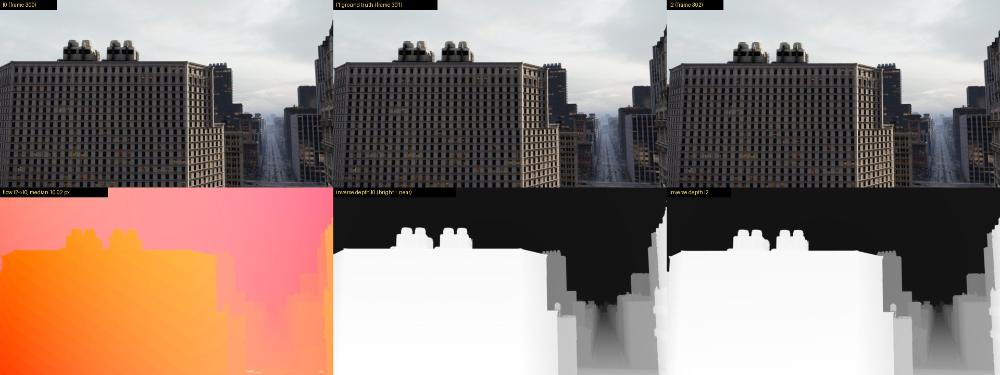
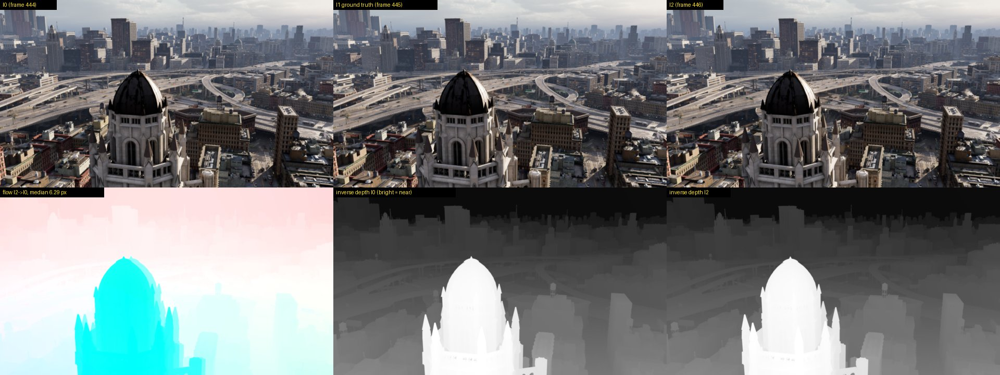
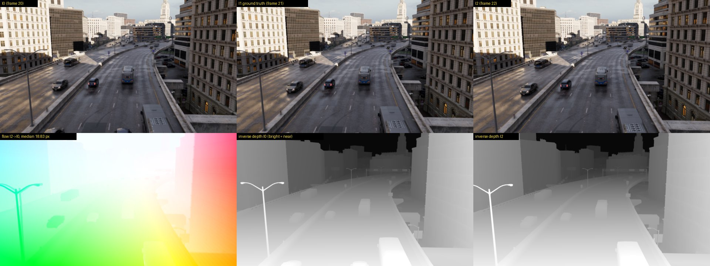
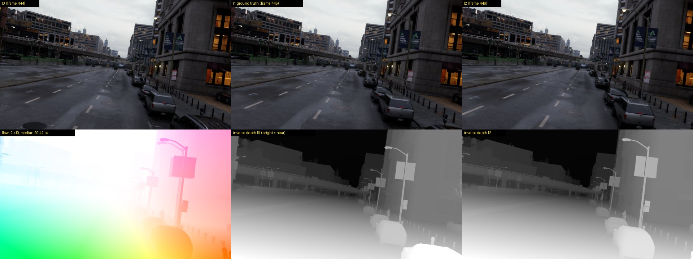
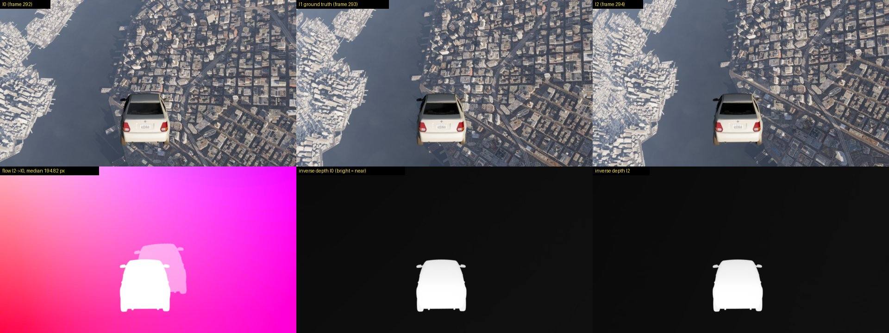

# City 插帧样例数据（夹 1 帧）

「RIFE 加运动向量和深度作为额外输入」

## 数据怎么来的

- **场景：** UE 5.8 的 City Sample（`Big_City_LVL`），用 Movie Render Queue 渲染，60fps，1280×720。
- **渲染设置：** 空间采样 8 次（不用 TAA/TSR）；关掉运动模糊、景深、胶片颗粒、色差、暗角；手动曝光 −6.5 EV，亮度不会在帧之间漂移。
- **原始输出：** 每帧一个 EXR（约 20 MB），里面有四层：`FinalImage`（画面）、`MovieRenderQueue_WorldDepth`（平面深度，厘米）、`MovieRenderQueue_MotionVectors`（运动向量）、`InvDepth`（逆深度）。这里给的是处理好的格式，不是原始 EXR。
- **夹 1 帧：** 一组是相邻三帧 (t, t+1, t+2)，t 是偶数。I0 = 第 t 帧，I1 = 第 t+1 帧（中间帧真值），I2 = 第 t+2 帧。相当于游戏按 30fps 渲染，再插出 60fps。

## 每组的文件

| 文件 | 形状和类型 | 含义 | 推理时能用吗 |
|---|---|---|---|
| `I0.png`、`I2.png` | 720×1280×3，uint8 | 两张输入帧（sRGB，已经过 UE 的色调映射） | 能 |
| `I1_gt.png` | 720×1280×3，uint8 | 中间帧真值 | 不能，只做训练目标 |
| `flow_I2_to_I0.npz`（键 `flow`） | 720×1280×2，float16，单位像素 | I2 的像素 (x, y) 在 I0 里的位置是 (x + flow[..., 0], y + flow[..., 1]) | 能 |
| `invdepth_I0.npz`、`invdepth_I2.npz`（键 `invdepth`） | 720×1280，float16，单位 1/米 | 逆深度 = 1 / 平面深度（米）。越大越近，天空约为 0；这几组的范围是 0 到 0.13 | 能 |
| `meta.json` | | 帧号、为什么挑这组、运动大小、预训练 RIFE 和两段拼接 v3 的 PSNR / SSIM | |
| `vis/` | PNG | 运动向量的可视化（色相表示方向，饱和度表示大小）和逆深度的可视化 | |

## 运动向量要注意的地方

1. **方向和网格：** `flow` 定义在 I2 的像素网格上，从 I2 指回 I0。用 I0 重建 I2 就是反向采样：I2(x) ≈ I0(x + flow(x))，`check_sample.py` 就是这样验证的。RIFE 内部的光流从中间帧出发（中间帧→I0、中间帧→I2），定义在中间帧的网格上。按匀速假设，可以近似成中间帧→I0 ≈ flow / 2、中间帧→I2 ≈ −flow / 2，但这仍是 I2 网格上的值；严格做要先把它投射到中间帧网格上（我们的"两段拼接"就是这么做的）。
2. **它是近似的：** 项目里有随机生成的路人和车，同一段镜头按 30fps 和 60fps 各录一遍，内容不一样，所以只能录 60fps。I2→I0 的运动向量是把 I2 自己的 60fps 运动向量和中间帧的 60fps 运动向量首尾接起来得到的。对一直看得见的点，接出来的终点和原生 30fps 运动向量一样；在物体边缘、在中间帧被挡住的点上会不同。训练和测试都用这种接出来的版本，保持一致。
3. **边缘被平均过：** 渲染时空间采样 8 次，深度、逆深度和运动向量在物体边缘都是前景和背景的平均值（游戏里不是这样，游戏每帧每像素只有 1 个采样）。这里的 `flow` 已经做过"膨胀"：每个像素先取 3×3 邻域里离相机最近那个像素的运动向量，和 TAA、FSR 的做法一样；中间帧那一段按最近像素取值。逆深度是 EXR 里的原始值，没有膨胀，边缘有混合值。
4. **原始 EXR 里运动向量的解码**（以后处理整个数据集时要用）：mv = (R − 0.5, G − 0.5) × (2W, −2H)，单位像素；含义是"这一帧的位置减去上一帧的位置"，所以上一帧的位置 = x − mv。UE 只给往回指的运动向量，没有往前指的。`InvDepth` 层就是 100 / `WorldDepth`（厘米换算成米）。
5. **中间帧自己的运动向量（I1→I0）推理时拿不到**，不能作为 (4) 的输入。只有方法 (5) 拿引擎光流当蒸馏老师时，才会在训练里用到它。这里没有放，需要的话可以补。

## 五组样例

| 组 | 为什么挑 | 运动中位数 / 最大（px） | 预训练 RIFE PSNR（dB） | 两段拼接 v3 PSNR（dB） |
|---|---|---|---|---|
| `StreetToSkyline_0301` | 小运动、画面简单，两种方法都好 | 10.0 / 17.9 | 39.79 | 38.33 |
| `CloverSweep_0445` | 遮挡关系变化：圆顶前景在楼群背景上移动 | 6.3 / 63.8 | 28.04 | 28.30 |
| `HighwaySweep_0021` | 近处重复的窗格纹理，RIFE 容易对错格 | 18.8 / 69.9 | 21.29 | 31.98 |
| `StraightawaySweep_0445` | 快速向前开，画面向四周放大，深度跨度大 | 29.4 / 192.5 | 28.80 | 30.43 |
| `CarCarsh_0293` | 镜头高速滚转，运动约 200 px，前景是车 | 194.8 / 278.3 | 16.92 | 17.95 |

"两段拼接 v3"不用网络，只靠上面的运动向量和深度把 I0、I2 的颜色搬到中间帧。它是方法 (1) 的当前版本，详见项目文档第三阶段。

每组的总览图（上：I0 | 中间帧真值 | I2；下：运动向量 | I0 逆深度 | I2 逆深度）：







## 读取示例

```python
import numpy as np
from PIL import Image

g = 'CloverSweep_0445'
I0 = np.asarray(Image.open(f'{g}/I0.png'), np.float32) / 255           # (720, 1280, 3)
I2 = np.asarray(Image.open(f'{g}/I2.png'), np.float32) / 255
gt = np.asarray(Image.open(f'{g}/I1_gt.png'), np.float32) / 255
flow = np.load(f'{g}/flow_I2_to_I0.npz')['flow'].astype(np.float32)     # (720, 1280, 2)，像素，I2 网格
inv0 = np.load(f'{g}/invdepth_I0.npz')['invdepth'].astype(np.float32)   # (720, 1280)，1/米
inv2 = np.load(f'{g}/invdepth_I2.npz')['invdepth'].astype(np.float32)
```

## 自检：`check_sample.py`

运行 `python check_sample.py <组名>`（只需要 numpy 和 Pillow）。它用 `flow` 把 I0 反向采样到 I2 的网格上，再和 I2 比较；还用逆深度判断这个点在 I0 里是不是同一个表面（逆深度相差 15% 以内）。五组的结果：

| 组 | 不做变换，I0 对 I2 | 按 flow 变换后，全部像素 | 只算两帧都看得见的像素 |
|---|---|---|---|
| StreetToSkyline_0301 | 15.86 dB | 28.10 dB | 38.23 dB（97.6% 的像素） |
| CloverSweep_0445 | 15.69 dB | 23.82 dB | 30.12 dB（95.9%） |
| HighwaySweep_0021 | 16.65 dB | 28.06 dB | 33.49 dB（97.6%） |
| StraightawaySweep_0445 | 20.83 dB | 27.10 dB | 33.58 dB（73.6%） |
| CarCarsh_0293 | 14.04 dB | 20.45 dB | 31.66 dB（66.8%） |

变换后 PSNR 明显升高，说明方向和单位都对。剩下的误差主要在两帧之间被挡住或新露出来的区域，以及物体边缘。

## 完整数据

七段镜头一共约 4,900 帧。夹 1 帧可用的有 2,246 组：StraightawaySweep 只用第 521 帧以前（之后进入高架下，画面几乎全黑），SlowSidewalkPan 只用第 35 帧以后。完整数据（EXR 共约 97 GB）还在本地，需要时可以按这里的格式导出。
